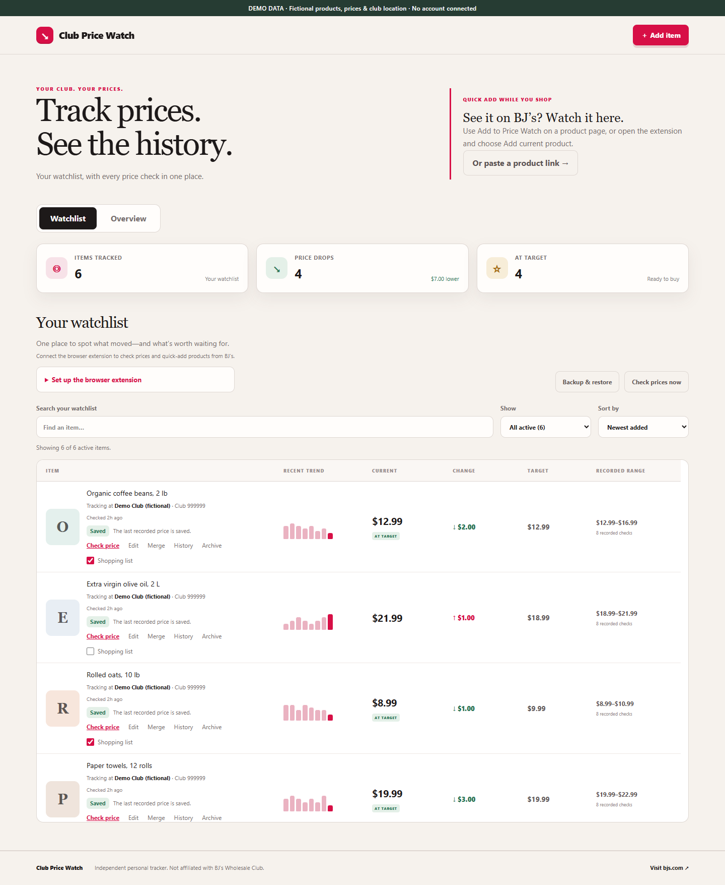
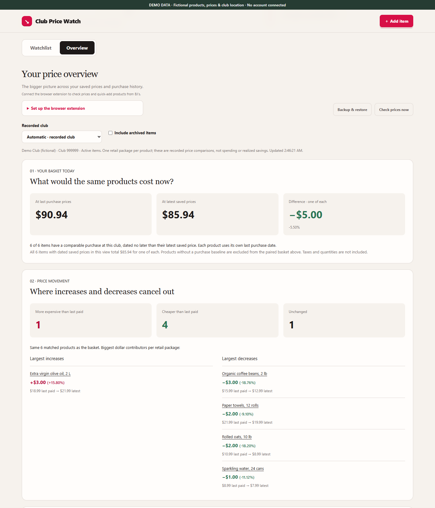
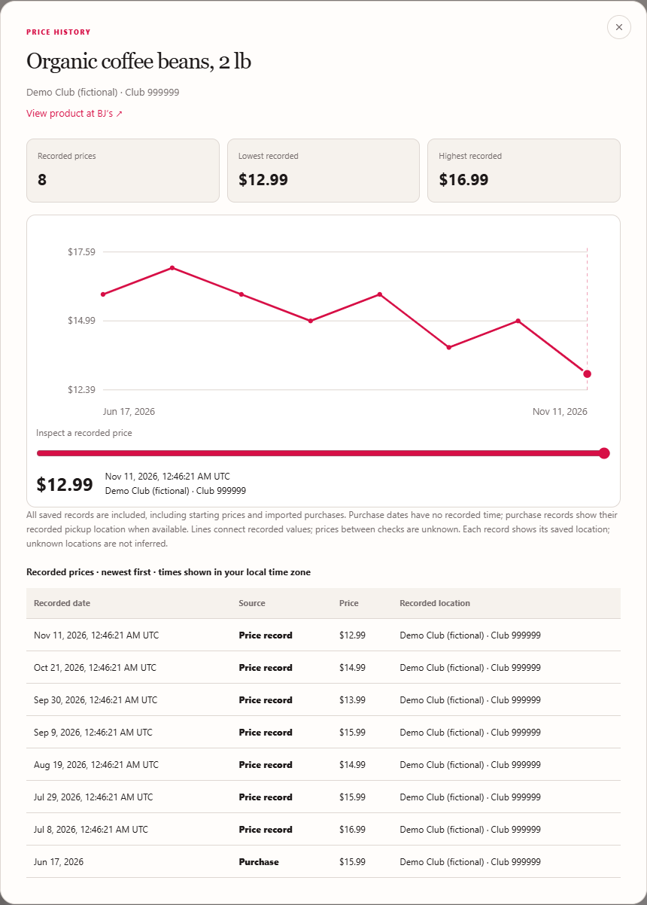

# Club Price Watch

A self-hosted BJ’s Wholesale Club price watchlist with a companion browser extension.
Your normal signed-in browser checks prices; the dashboard and database run on your PC
or Docker host. Independent project; not affiliated with or endorsed by BJ’s.

## Screenshots

All screenshots use invented products, prices, purchase history and a fictional club.
No personal account or real shopping data is shown.



<details>
<summary>Price overview and full history</summary>

Compare a matched basket with previous purchase prices and see what increased or decreased.



Inspect recorded prices, dates and club provenance for an individual product.



</details>

See the [synthetic preview](source/screenshots/README.md) to refresh these screenshots safely.

## Features

- Watchlists, targets, shopping selections, search, sorting and archiving.
- Full price history with dates, sources and recorded club locations.
- Reviewed order-page import of unit prices, order dates and verified club numbers.
- Manual duplicate merging with remembered product links.
- Overview: matched baskets, movement, opportunities, monthly trends and coverage.
- JSON backup/restore for archived items, merged links and full history.
- Windows startup and a production Docker/SQLite server.

## Club locations come from your items

There is no global store ID, default club or location to edit in source code.
An imported item's reviewed club number becomes its tracking location. Each price check
requests that item's club and rejects prices from another club. Items at different clubs
can be checked in the same run without changing configuration.

Import purchases with a verified club number, or use **Set club** for an item whose
location is unknown. Manual adds also accept a recorded club number. Unknown-location
items keep their history but cannot be checked until a location is supplied; no club is
guessed. Imports without a purchase price still retain their reviewed club location.
Public pickup links can provide a club ID or locator area dynamically; if a public lookup
cannot verify a club, review the number instead of assuming the nearest store.

The API path identifier in the price-service URL is not a club number. Keep the extension
identity/public key unchanged. Version 2.2 uses protocol 3: rebuild/reload the extension
and refresh app and product pages when upgrading; older protocols disconnect safely.

## Run on Windows

Requirements: Node.js >=22.13, npm, and .NET 8 SDK for the full Windows release build.
The published optional native launcher needs .NET 8 Runtime.

For development or a full native release, run these commands from source/:

```sh
npm ci
npm run check
npm run release
```

Double-click **Start Club Price Watch.bat** in the repository root. Keep its server
window open. On the first run, it installs dependencies and generates the browser
extension automatically; this needs an internet connection but no .NET build.
The app opens at **http://localhost:3000**. The launcher keeps its output visible until
you press a key, including when another app server is already running.

For extension setup, open the same batch file and press **2**. Setup opens Extensions
and copies the generated folder path. Enable developer mode, choose **Load unpacked**,
and select checker/package/BrowserExtension/. Keep that folder at the same absolute
path after loading it. Reload after rebuilding, then refresh app and BJ’s pages.
Use a supported Chromium browser with your normal BJ’s login.

## Docker / Synology

See [Docker setup](source/docker/README.md). No Windows EXE or .NET installation is
needed for the server. This source does not assume a published registry image exists.

## Daily use

Add products by URL, the popup or the product-page button. Existing products reuse
their entry. The runner offers Test and Save. Failed checks preserve good prices;
dry runs never write. No unattended weekly checking schedule is installed.

On an order-detail page, open **Track purchased items**, review prices/date/club,
select products and confirm. Missing values require review. Purchase prices add
historical observations without replacing newer current prices. Only reviewed
selected fields are saved.

Use **History** for full records, **Edit** for name/target and **Archive** to hide
without deleting history. Use **Merge** after comparing variety, size and product
links. It keeps the chosen item’s details and combines history; a pre-merge backup
can undo it.

Overview uses same-club comparisons and shows coverage/stale prices. Basket amounts
mean one retail package each, not actual spending or realized savings. Sparse data
does not establish sale cycles or predict future prices.

## Storage and privacy

- Windows data: source/.wrangler/state/. Docker data: persistent /data mount.
- Preserve data and migrations. Use **Backup & restore** before upgrades or moving hosts.
- Backups support versions 1–4, up to 20 MB, 1,000 product identities and 20,000 history points.
- Changing extension Server address does not migrate data.
- APIs have **no application-level authentication**. Restrict network access and protect
  remote access separately. Origin checks do not make an exposed server private.
- The extension has no cookie/debugger permission and does not export browser profiles.
- BJ’s owns login and verification. Observed endpoints/page markup may change and are
  not represented as a supported public API. Do not bypass access restrictions.
- Never post account details, captures, live backups or private paths in public issues.

See [development](source/README.md), [architecture](source/ARCHITECTURE.md),
[contributing](CONTRIBUTING.md), [security](SECURITY.md) and
[release preparation](PUBLIC_RELEASE.md).

## License

[GNU General Public License v3.0](LICENSE). Existing license text is preserved unchanged.
